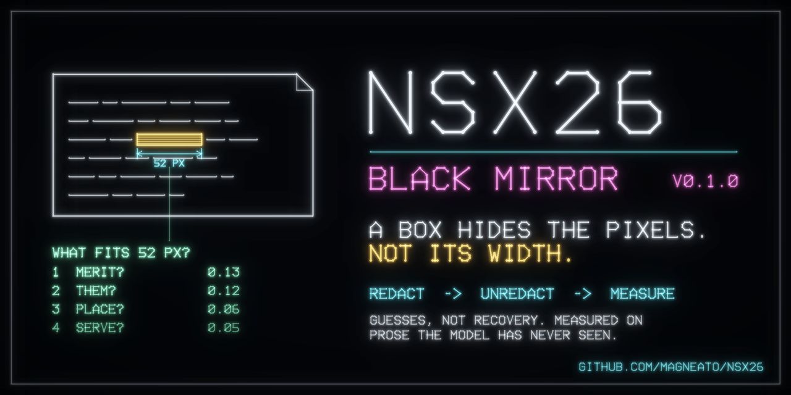
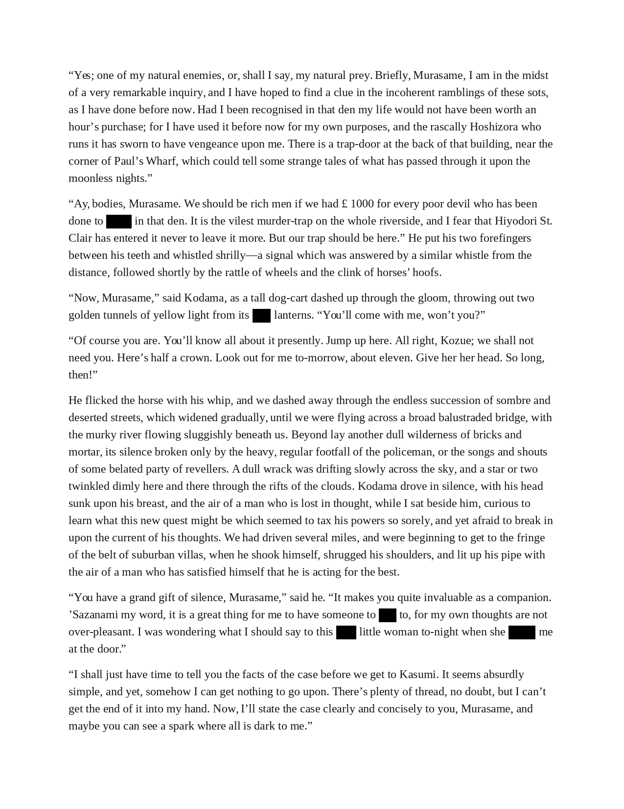
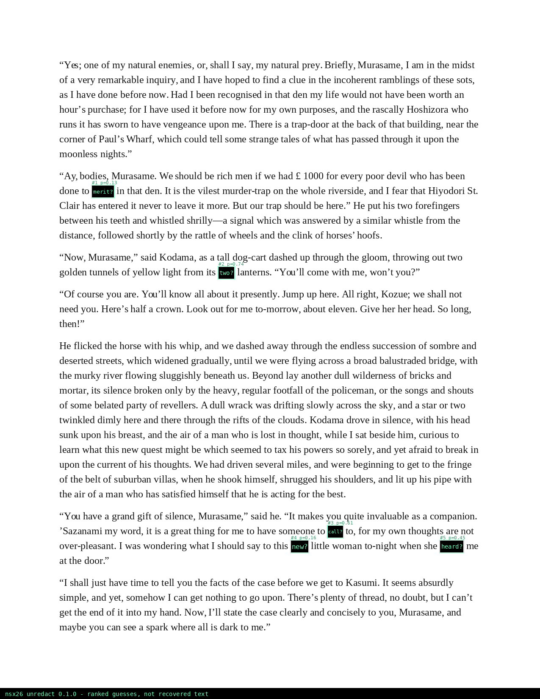

<p align="center"></p>

# nsx26 · Black Mirror

[](https://github.com/magneato/nsx26/actions/workflows/ci.yml)
[](https://magneato.github.io/nsx26/)
[](LICENSE)

**A flattened redaction box destroys the pixels under it, but not its own width.** In a known font only some
words are that wide, and the visible words around the box say which of those fit. This repository holds two
tools and the measurement that connects them:

* **`redact.sh`** covers text on a page image with boxes that are really flat: a new RGB PNG with nothing under
  the box, no layers, no alpha, no metadata, checked after writing. It can also apply the defences measured below.
* **`unredact.sh`** looks only at a redacted image and ranks what each box could hide. Its output is a list of
  **guesses with the model's belief**, never a recovery. It is wrong often, and it says so.
* **`unredact.sh evaluate`** runs the two against each other on prose the model has never seen and reports how
  often the first guess is right, with and without each defence.

Use it to audit your own redactions, or documents you are entitled to examine.

## Measured

Pages are set from two books whose authors are absent from the word model's training text (Doyle's *Adventures
of Sherlock Holmes*, Fitzgerald's *The Great Gatsby*). On each page, words are picked uniformly at random (any
length, known to the model or not), redacted by `redact` exactly as the command does, written to disk as PNG,
and handed to `unredact` alone. Its guesses are scored against `redact`'s answer key.

<!-- results:start -->
| condition | what the redactor did / what the attacker knows | boxes | found | first guess right | right answer in top 5 | texts that fit (median) |
| --- | --- | ---: | ---: | ---: | ---: | ---: |
| `black` | solid box over the ink of one word | 144 | 100% | **47%** | 69% | 3,662 |
| `noise` | the same boxes filled with random static | 144 | 98% | **45%** | 68% | 3,807 |
| `scan` | solid box, then printed and scanned (blur, grain, JPEG q75) | 144 | 100% | **46%** | 67% | 3,634 |
| `width-only` | solid box, attacker ignores the words around it | 144 | 100% | **19%** | 38% | 5,897 |
| `pairs` | one box over two consecutive words | 144 | 100% | **15%** | 31% | 190,420 |
| `names` | solid box over a proper name; attacker knows it is one of 90 listed names | 133 | 100% | **25%** | 89% | 10 |
| `names-mixed` | same boxes; the 90 names are only added to the vocabulary | 133 | 100% | **0%** | 5% | 119,458 |
| `pad3` | box 3 px wider than the ink each side; attacker assumes up to 2 | 144 | 100% | **0%** | 0% | 6,531 |
| `pad3-known` | same boxes; attacker knows the padding is up to 3 | 144 | 100% | **6%** | 11% | 7,689 |
| `uniform` | the defence: every box 160 px wide (multiples of 160 if longer) | 144 | 100% | **0%** | 0% | 359,129 |

Measured by `unredact.sh evaluate` (18.7 min): 24 pages, 6 boxes per page per condition, seed 2026. Test books (authors absent from the word model): The Adventures of Sherlock Holmes (Arthur Conan Doyle, Gutenberg 1661); The Great Gatsby (F. Scott Fitzgerald, Gutenberg 64317). Fonts LiberationSerif-Regular, LiberationSans-Regular, DejaVuSerif at 20, 22, 24, 26 px. Word model: 3,544,215 words, vocabulary 34,499. tesseract 5.5.0, Python 3.14.4, numpy 2.5.3, Pillow 12.3.0.

* Width alone leaves a median of 3,662 texts (one or two words) that fit a box; with the words around it the first guess is right 47% of the time, against 19% from width alone.
* Random static instead of black: 45%. The box keeps its width either way.
* Printed and scanned (simulated): 46%.
* Two words under one box: 15%.
* Names: with the 90 stand-in names merely added to the vocabulary, the first guess is right 0% of the time; an attacker who knows the box holds one of those 90 puts the right one first 25% of the time and in the top five 89%.
* Boxes 3 px wider than the ink on each side: 0% for an attacker who assumes tight boxes, 6% for one who knows the padding (the wider width window admits more candidates).
* Every box 160 px wide: **0%**.

Of the `black` boxes, 97% hid words the model knows at all; on those the first guess was right 48% of the time. The model's average belief in its first guess was 0.59 against an accuracy of 0.47: its beliefs are overconfident and should not be read as probabilities.
<!-- results:end -->

The search settings (width tolerance 1 px, boxes up to 2 px wider than the ink on each side, a 1 px width
preference) were chosen on pages from a *training* book, Austen's *Emma*, left out of a temporary model for the
purpose (`./unredact.sh evaluate --calibrate`; grid in [`results/calibration.json`](results/calibration.json)).
The winner beat the runner-up by one box in 72, so read it as "one of several equally good settings", not an optimum.
The test books played no part in choosing them. Every case is listed in `results/cases.json`.

**What it does not show.** Clean, single-column, left-aligned prose in three common fonts, plus one simulated
print-and-scan. Justified text, other fonts, real scans and real documents are not measured here; do not assume
these numbers carry over. The word model knows 19th- and early 20th-century English. Static-filled boxes over the
shortest words are sometimes not found (the `found` column); every box not found counts as a miss.

## A page, start to finish

All of this is the tools' unedited output ([`docs/demo/`](docs/demo), regenerated by `python tools/make_demo.py`).

<table><tr>
<td width="50%"><br><sub><code>redact.sh</code>: five words.</sub></td>
<td width="50%"><br><sub><code>unredact.sh</code>: first guess and belief in each box.</sub></td>
</tr></table>

The proper names on the demo page are stand-ins: [`corpus/names.txt`](corpus/names.txt) holds 90 classical Japanese
words for weather, seasons, birds and plants (Hotaru, Kasumi, Shigure, ...), written over the passage's real names
by `redact.sh sample --names`. The `names` row of the table measures an attacker who holds that list.

## Install and run

**Ubuntu 24.04 / 26.04**

```bash
git clone https://github.com/magneato/nsx26 && cd nsx26
./setup.sh            # apt: tesseract-ocr, fonts; .venv with numpy + Pillow; corpus; word model (~1 min)
```

**Windows 11** (PowerShell)

```powershell
git clone https://github.com/magneato/nsx26; cd nsx26
powershell -ExecutionPolicy Bypass -File .\setup.ps1   # winget: Python 3.12, Tesseract; .venv; fonts; corpus; model
```

On Windows use `.\redact.cmd` and `.\unredact.cmd` with the same arguments as below.

**What has been verified where.** Ubuntu 26.04.1: everything in this README, including the benchmark. Windows:
the Windows builds of CPython 3.12.10 and Tesseract 5.4.0 under Wine 11 ran the test suite (18/18), the `.cmd`
wrappers, the font download and a full redact → unredact → score run (`tools/windows-check/run.sh` repeats this);
`setup.ps1` ran under PowerShell 7.4. It has not been run on a Windows 11 machine by the author; CI runs the tests
on `windows-latest` on every push and the full `setup.ps1` on version tags. Test pages are set at the fonts'
unhinted metrics on every platform, so they are pixel-for-pixel the same layout on Linux and Windows.

```bash
./redact.sh sample page.png --book 1661 --seed 3          # set a test page from the corpus (+ .layout.json)
./redact.sh page.png -o red.png --term talk --term "said he" --key red.key.json
./redact.sh page.png -o red.png --regex "[0-9]{4}" --fill noise
./redact.sh page.png -o red.png --term Kasumi --uniform 160   # the defence: every box 160 px wide
./unredact.sh red.png                                     # -> red.guess.json, red.guess.png
./unredact.sh red.png --names corpus/names.txt --names-only   # attacker with a list of candidates
./unredact.sh score red.guess.json red.key.json           # compare with the answer key
./unredact.sh evaluate                                    # the table above (~20 min); --pages 4 for a look
python -m unittest discover -s tests                      # 18 tests, including the real CLI end to end
```

`redact.sh` writes `OUT.json` beside the image with only what the image already shows (box geometry, fill, tool
version): no redacted text and no hash of the original, since a hash would let a guess be confirmed. The answer
key (`--key`) holds the hidden text; keep it as private as the original. Terms that are not found are reported on
stderr only, and the command exits with status 3.

## How `unredact` works

1. **Boxes.** Solid dark regions trimmed to the columns and rows that are almost entirely dark, or regions of random
   static (pixels that differ from both neighbours and are mid-grey), each edge found to the pixel.
2. **The visible words.** `tesseract` reads the page with the boxes painted white, in reading order.
3. **The font.** For each installed candidate font, fit *measured width = size × width at 1 px + offset* over the
   readable words; the font with the smallest median residual wins (about half a pixel on the test pages).
4. **Width.** From the vocabulary (and any `--names`), keep texts of up to two words whose ink would be as wide as
   the box. Ink, not advance: the bearing before the first and after the last letter is subtracted.
5. **Context.** An interpolated, absolutely discounted trigram model with Kneser-Ney continuation counts, trained
   on 19 public-domain books (3.5 million words), scores each candidate with the three words before it and the two
   after. A name outside the vocabulary shares the model's own probability of an unseen word.

No randomness anywhere: the same image, model and settings give the same JSON (a test checks this). The model is
counts in sorted arrays; training takes seconds.

## Repository

| path | what |
| --- | --- |
| `redact.sh` `unredact.sh` / `.cmd` | the two commands (Linux / Windows) |
| `nsx26/` | the package: `redact`, `unredact`, `vision` (boxes, OCR), `fonts`, `guess`, `model`, `page`, `bench` |
| `corpus/books.tsv` | the 21 Gutenberg books and their train/test split by author |
| `corpus/names.txt` | 90 stand-in names |
| `results/` | the benchmark's `results.json`, every case in `cases.json`, the calibration grid |
| `docs/` | the GitHub Pages site (Jekyll), its art and the demo |
| `tools/` | `fetch.py` (downloads), `make_demo.py`, `make_art.py` + `vectrex.py` (the vector artwork), `build_site.py`, `windows-check/` |
| `tests/` | unit and end-to-end tests |

## Credits

Text: [Project Gutenberg](https://www.gutenberg.org/) public-domain editions, downloaded by `setup` and never
redistributed here. Fonts: Liberation (SIL OFL) and DejaVu (free licence), from the system or downloaded at setup.
OCR: [Tesseract](https://github.com/tesseract-ocr/tesseract). The artwork is drawn by `tools/make_art.py` as a
tribute to vector displays of the early 1980s.

MIT licence, © 2026 Neural Splines LLC. See [CHANGELOG.md](CHANGELOG.md) for what is in v0.1.0.
